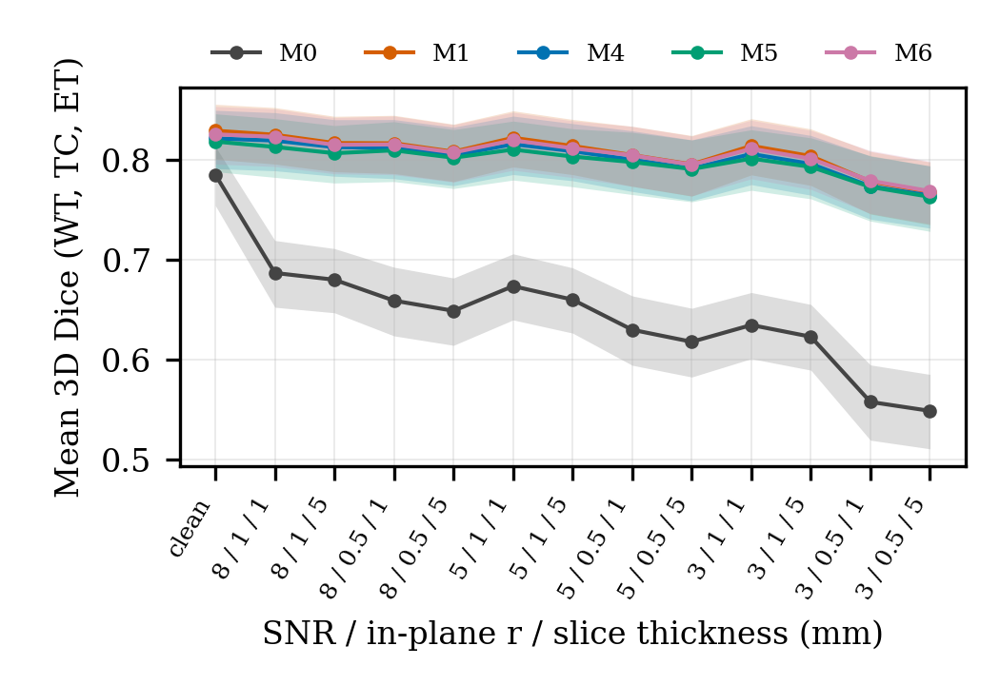
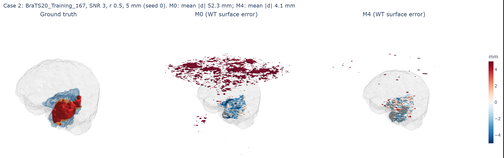

# Argus: brain tumour segmentation under simulated low-field MRI

**Does splitting MRI into low- and high-spatial-frequency bands make tumour segmentation robust to low-field
scanner degradation?** A pre-registered, controlled comparison on BraTS 2020 with morphometric validation
(ECTE408 research project).

**Answer: no, and training on degraded scans is what works.** Training a U-Net on simulated low-field scans
raised worst-condition Dice from 0.55 to 0.77 and removed spurious tumour. A dual-stream frequency-band network
(M4) added nothing over a plain U-Net trained on the same data (all three pre-registered hypotheses not
supported, differences of about 0.004 Dice, below training noise). With degradation-aware training, tumour
volumes stayed as reliable at the worst condition as on clean scans.

**Paper:** [`docs/paper/main.pdf`](docs/paper/main.pdf) (IEEE format, source `docs/paper/main.tex`),
working draft with full detail in [`docs/PAPER_DRAFT.md`](docs/PAPER_DRAFT.md).




*Ground truth vs the clean-trained baseline (M0) vs the dual-stream model (M4) at SNR 3, half resolution, 5 mm
slices. Prediction surfaces coloured by signed distance to the true boundary.*

## Key results (74 test patients, 3 seeds)

| Model | Training | Clean Dice | Worst-condition Dice | WT volume error, worst | WT volume ICC, worst |
|---|---|---|---|---|---|
| M0 U-Net | clean | 0.786 | 0.549 | 25.8 % | 0.74 |
| M1 U-Net | degraded | 0.830 | 0.768 | 7.1 % | 0.94 |
| M4 dual-stream (proposed) | degraded | 0.822 | 0.765 | 7.0 % | 0.94 |
| M5 low band only | degraded | 0.819 | 0.763 | 7.8 % | 0.93 |
| M6 early fusion | degraded | 0.826 | 0.769 | 7.2 % | 0.94 |

Dice: mean of WT/TC/ET, full 3D. Worst condition: SNR 3, in-plane resolution halved, 5 mm slices. Volume
agreement on seed 0. Much of M0's false tumour lies outside the brain; with predictions masked to the brain,
the augmentation gain at the worst condition is +0.13 Dice (95 % CI 0.11-0.14) instead of +0.22. Full statistics: [`docs/RESULTS_STATS.md`](docs/RESULTS_STATS.md) and `tables/`.

## Study design

- **Data:** BraTS 2020 training set, 369 patients, fixed split 258 / 37 / 74 (`data/splits/split_v1.json`).
- **Degradation (DEC-005):** slice thickness 1 or 5 mm, k-space truncation r 1.0 or 0.5, complex noise inside
  the acquired k-space band at SNR 8 / 5 / 3, plus clean = 13 conditions. Noise seeded per (patient,
  condition) so every model sees identical test volumes.
- **Models (DEC-007):** five capacity-matched 2D U-Nets (4.2-4.4 M parameters), 20 epochs, seeds 0, 1, 2.
- **Hypotheses (DEC-006, fixed before training):** H1 M4 > M1 at worst; H2 M4's drop < M1's; H3 M4 > M6.
  Paired Wilcoxon, Holm correction, and a rule that differences below twice the seed-to-seed SD are training
  noise.
- All decisions are dated in [`docs/DECISIONS.md`](docs/DECISIONS.md); the full research log, including the
  failed first pipeline, is [`docs/LAB_NOTEBOOK.md`](docs/LAB_NOTEBOOK.md).

## Repository layout

```
pilot/pilot.py          degradation physics (degrade_volume), normalisation, Dice, noise seeding
python/                 data preprocessing, models (U-Net, dual-stream, factory), decomposition, stats
training/               prepare.py (BraTS -> arrays), train_v2.py, Colab / Kaggle notebooks
evaluation/             evaluate_v2.py (test set, 13 conditions), masked sensitivity analysis, notebooks
matlab/                 morphometrics, agreement analysis, diagnostic figures, 3D renderer, spectral check
matlab/reference/       independent MATLAB physics (degrade_volume.m, decompose_slice.m) + parity tests
viz3d/                  interactive 3D viewer (Plotly) and the paper's 3D figures
results/                train_v3/ checkpoints and logs, raw_metrics_v2.csv, morphometric CSVs
tables/                 statistics output (hypotheses, secondary tests, curves, noise floor)
figures/                all figures
docs/                   paper (docs/paper/), draft, decisions, lab notebook, roadmap, results summary
tests/                  pytest suite (65 tests: physics, metrics, stats, splits, evaluation, viewer, parity)
legacy/                 the superseded v1 pipeline, kept for transparency (see legacy/README.md)
```

## Reproducing

Requirements: Python 3.10+ (`pip install -r requirements.txt`), MATLAB R2025a+ with the Image Processing
Toolbox for the morphometrics. Place BraTS 2020 (Kaggle `awsaf49/brats20-dataset-training-validation`) under
`archive/BraTS2020_TrainingData/MICCAI_BraTS2020_TrainingData`, or set `BRATS_ROOT`.

```bash
# 1. Train (GPU; or training/train_colab.ipynb / train_kaggle.ipynb)
python training/prepare.py --raw_dir <BRATS_ROOT> --work <work_dir> --sets train,val
python training/train_v2.py --work <work_dir> --out results/train_v3 --model M4 --seed 0

# 2. Evaluate on the test set once, all 15 checkpoints (results/train_v3/ is included)
python -m evaluation.evaluate_v2 --raw_dir <BRATS_ROOT> --split test --confirm_test

# 3. Statistics -> tables/
python -m python.analysis.stats

# 4. Morphometrics and figures (MATLAB, from the repo root)
matlab -batch "run('matlab/check_pred_grid.m'); SOURCE='pred'; run('matlab/volumetrics.m'); clear; run('matlab/agreement_report.m')"
matlab -batch "run('matlab/diagnostic_report.m'); clear; run('matlab/render3d_stage3.m'); clear; run('matlab/spectral_check.m')"

# 5. 3D viewers and figures
python -m viz3d.viewer --compare     # interactive HTML per case -> figures/interactive/ (not in git, 20-40 MB)
python -m viz3d.paper_figures        # static 3D figures for the paper

# 6. Tests and paper
python -m pytest tests
tectonic docs/paper/main.tex         # or upload docs/paper/ and figures/ to Overleaf
```

## Team

- **Joshua Koshy:** redesign and training (Steps A-C), MATLAB morphometrics, agreement analysis, 3D renderer,
  MATLAB physics port, paper.
- **Muhammad Nazir Ahmed Mapkar:** test-set evaluation, statistics, literature review and references,
  interactive 3D viewer (`viz3d/`).
- **Mayank:** original data pipeline, model architectures and physics implementation.
